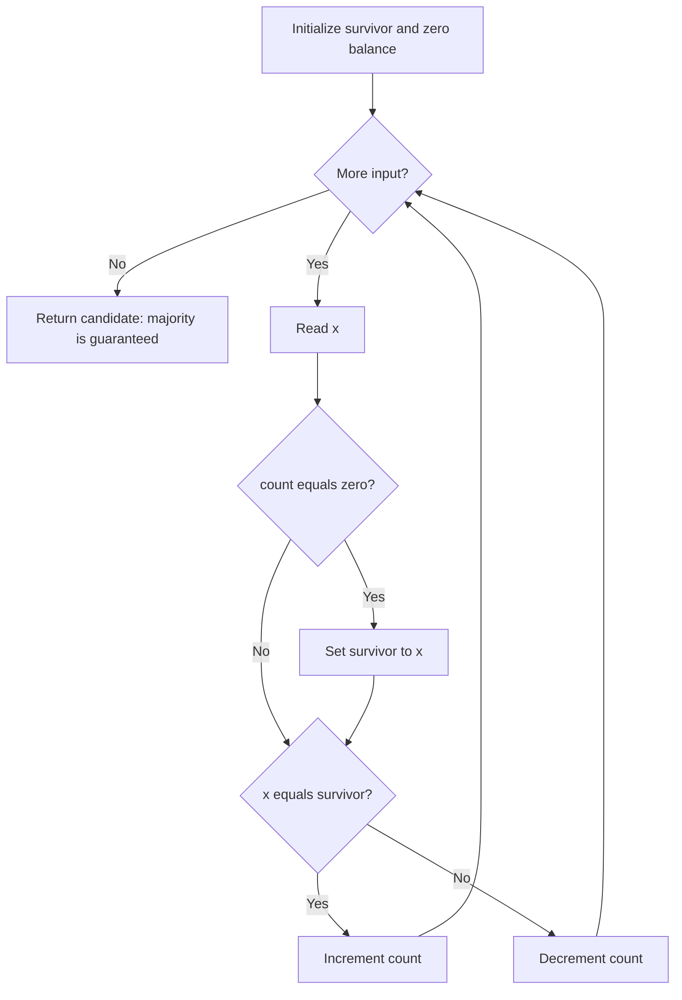

# 169. Majority Element

## Clarify the contract

Return the value occurring more than `floor(n / 2)` times. The supplied statement
guarantees a nonempty array and that such a value exists. No sorting is assumed.

A majority is stronger than a mode (the most frequent value). For example,
`[1,1,2,3]` has a unique mode but no strict majority. This distinction is what
makes the final cancellation technique valid without a verification pass.
Two strict majorities cannot coexist: together their counts would exceed `n`.
Uniqueness alone, however, is not the proof of the voting algorithm.

## Solution evolution

### 1. Brute force: recount each candidate

For each value in the array, scan the entire array to count its occurrences.
Return it if its count exceeds `n / 2`. This is correct because every possible
answer appears in the input. Worst-case time is O(n²), with O(1) extra space.

What to say:

> “I could count each candidate with a full scan, but that repeats counting
> work. I can store frequencies so each input value updates its count once.”

### 2. Your baseline: count frequencies in a map

For each `x`, increment `frequencies[x]`. Then find the entry with count greater
than `n / 2`. Under the majority guarantee, choosing the largest count also works.
For `[2,2,1,1,1,2,2]`, the final map is `{2: 4, 1: 3}`; return 2.

With expected constant-time hash-map operations, total time is expected O(n),
and extra space is O(d), where `d` is the number of distinct values, at most n.
You may return as soon as a count exceeds `n / 2`, or track the largest frequency
during the scan to avoid a separate map scan. These refinements do not remove
the map or change its asymptotic memory cost.

What to say:

> “A frequency map gets me to expected linear time, but it stores a count for
> every distinct value. The majority is more frequent than all other values
> combined. Can I use that stronger guarantee to avoid storing exact counts?”

### 3. Key observation: cancel different values in pairs

Let the majority be M, appearing `m` times among `n` elements, with `2m > n`.
Remove a pair of different values:

- If the pair contains M, the new counts obey `2(m - 1) > n - 2`.
- If neither value is M, M's count stays unchanged while the total decreases.

So M remains a strict majority after either kind of removal. Repeatedly canceling
different pairs cannot eliminate the majority. This means we need to track only
the unpaired values, rather than every original frequency.

```text
Input: [2, 2, 1, 1, 1, 2, 2]
        └─────┘  cancel a 2 with a 1
Remaining multiset: [2, 1, 1, 2, 2]
Cancel another (2, 1): [1, 2, 2]
Cancel another (1, 2): [2]
Survivor: 2
```

These are conceptual removals. The implementation neither deletes values nor
allocates a reduced array.

### 4. Boyer–Moore: represent the unpaired values with two variables

`survivor` is the current candidate; `count` is the number of its unmatched votes.
It is **not the largest frequency seen**, nor the total frequency of `survivor`.

If the balance is zero before processing a value, select that value as candidate.
A matching value adds one unmatched vote; a different value cancels one.
After all input, the guaranteed majority is the remaining candidate.

What to say:

> “I can cancel pairs of different values because the majority outnumbers
> everything else combined. I keep a candidate and an unmatched-vote balance.
> When the balance is zero, the next value starts a new candidate. A match adds
> a vote; a mismatch cancels one. This uses O(n) time and O(1) extra space.”

| Approach | Time | Auxiliary space | Observation leading onward |
| --- | --- | --- | --- |
| Recount each candidate | O(n²) worst case | O(1) | Reuse counts instead of rescanning |
| Frequency map | O(n) expected | O(d) | Exact frequencies are more information than necessary |
| Boyer–Moore voting | O(n) | O(1) | A strict majority survives cancellation |

## How the executable differs from your draft

Your original loop was:

```kotlin
var result = nums[0]
var count = 1
for (x in nums) {
    if (x == result) count++ else count--
    if (count == 0) {
        result = x
        count = 1
    }
}
return result
```

That version gives the first element an initial vote and processes it again.
It also immediately reuses a value as candidate after that value reduced the
balance to zero. Those choices do not match the simple unmatched-vote invariant
above. No failures were found in the original version during exhaustive ternary
inputs of lengths 1 through 9 with a majority, or in 100,000 generated valid
inputs; this testing is not a correctness proof or a counterexample.

The executable makes two coordinated changes for the standard formulation:

1. Initialize `count = 0`, because no values have been processed yet.
2. Select the candidate when the balance is zero **before** processing `x`.
   Then count that value exactly once; a mismatch that reaches zero stays at
   zero until the next iteration.

The current code names the candidate `survivor` and initializes it to 0 as a
placeholder. The first iteration replaces it before comparing, because the
balance is zero. Zero is not a sentinel and can also be a valid majority value.
Kotlin's expression `count += if (x == survivor) 1 else -1` counts each input once.

### Avoid counting a newly selected value twice

Setting `count = 1` in the zero-balance block and then running a separate matching
`if` increments it again. On `[1,2,2]`, that proposed version evolves as
`(1,2) → (1,1) → (1,0)` and incorrectly returns 1. The current code instead
evolves as `(1,1) → (1,0) → (2,1)` and returns 2.

If you set `count = 1` when selecting a candidate, subsequent matching logic
must be in an `else` branch. The current implementation simply selects the
candidate first, then applies one shared increment/decrement expression.

## Every iteration of the executable

Input: `[2,2,1,1,1,2,2]`. State pairs below are `(survivor, count)`.
Initial state is `(0,0)`.

| Index | x | Before | Action | After |
| --- | --- | --- | --- | --- |
| 0 | 2 | `(0,0)` | Zero balance: select 2; matching value adds a vote | `(2,1)` |
| 1 | 2 | `(2,1)` | Match: add a vote | `(2,2)` |
| 2 | 1 | `(2,2)` | Mismatch: cancel one vote | `(2,1)` |
| 3 | 1 | `(2,1)` | Mismatch: cancel the last vote | `(2,0)` |
| 4 | 1 | `(2,0)` | Zero balance: select 1; add a vote | `(1,1)` |
| 5 | 2 | `(1,1)` | Mismatch: cancel the last vote | `(1,0)` |
| 6 | 2 | `(1,0)` | Zero balance: select 2; add a vote | `(2,1)` |

Return 2. Notice that the final balance is 1, but 2 actually occurs 4 times.



## Correctness and limits

After every processed prefix, its values can be separated into canceled pairs
of unequal values and `count` remaining copies of `survivor`. At zero balance
there are no unmatched values. Selecting the next candidate starts a new group;
a match extends it, and a mismatch removes one unequal pair. This proves the
invariant by induction.

At the end, pair cancellation preserves the majority as shown above, so the
remaining candidate must be that majority. Each iteration consumes one input,
ensuring termination after n iterations. The method allocates no collections
and does not mutate `nums`: O(n) time and O(1) auxiliary space.

If the majority guarantee were removed, voting would only produce a candidate.
A second pass must count its actual occurrences and check `occurrences > n / 2`.
For example, `[1,2,3]` has no majority even though voting produces a candidate.
An API for that different problem would also need a way to report “no majority”.

## Interview rehearsal

> “I can start by counting frequencies in a hash map, which takes expected
> linear time and space proportional to the distinct values. But the majority
> occurs more often than all other values combined. Removing two different
> values preserves that majority, so I can cancel votes instead of storing
> frequencies. I track a candidate and its unmatched balance, choosing a new
> candidate whenever the balance is zero before processing the next value.
> The majority guarantee lets me return the survivor without verification.
> This takes linear time and constant extra space.”

Practice explaining why a unique most-frequent value is insufficient, why the
balance is not a frequency, and why a zero balance does not mean the full input
lacks a majority. Trace `[1,2,3,2,2]` before checking the local tests.
