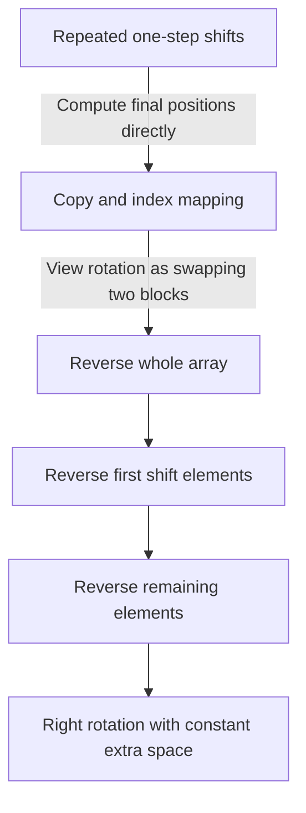

# 189. Rotate Array

## Contract and your implementation

Rotate a nonempty array right by nonnegative `k`, modifying the original array.
Return nothing (`Unit`, which Kotlin lets us omit). A full rotation restores the
array, so normalize with `shift = k % n` before doing work.

Your copy-based formula is correct. `189.kt` keeps that approach with `val` for
unchanging local references, the descriptive name `shift` instead of `K`, a loop
over `nums.indices`, and an early return when `shift == 0`.

It writes the result into the original array but allocates a copy, so it does
not meet the O(1)-extra-space follow-up. The separate `ReversalSolution.kt` does.

## Solution evolution

### 1. Baseline: rotate right by one, repeatedly

A one-step right rotation saves the **last** element, shifts the remaining values
right starting from the end, then writes the saved value at index 0.

```text
Start:       [1,2,3,4]       save 4
Move 3:      [1,2,3,3]
Move 2:      [1,2,2,3]
Move 1:      [1,1,2,3]
Restore 4:  [4,1,2,3]
```

Pseudocode for one step:

```text
saved = nums[n - 1]
for i from n - 1 down to 1:
    nums[i] = nums[i - 1]
nums[0] = saved
```

Working backward protects values still needed as sources. Moving forward would
overwrite them. Saving `nums[0]` and shifting left would instead rotate left.

Repeating exactly k times takes O(nk) time for positive k and O(1) auxiliary
space; an auxiliary array is not necessary. After normalization it performs
`shift` passes, taking O(1 + n × shift) time, with an O(n²) worst case over n
and k. The extra 1 accounts for returning immediately on a zero shift.

What to say:

> “I can save the last element, shift right, and put that saved value at the
> front. Repeating this is simple and needs constant space, but moves the same
> values over and over. Can I calculate each value's final position directly?”

### 2. Improve time: direct index mapping using a copy — your solution

An original index `j` moves to destination `(j + shift) % n`. Reverse that
relationship: output index `i` needs the original value at
`(i - shift + n) % n`.

The `+ n` avoids a negative index: Kotlin's `%` is a remainder operation, so
`-3 % 7` is `-3`, not `4`. Normalizing first guarantees that adding n once is
enough. Using raw k here could still leave a negative numerator when k > n.

Copy the input before writing. Otherwise, later reads can observe already
overwritten values. For `[1,2,3,4]` and shift 1, a forward loop reading from
the same array would write `4` to index 0, then read that new `4` to fill index 1.

What to say:

> “Each value moves right by k modulo the array length. I can read each output
> value directly from a snapshot at `(i + n - shift) % n`. This removes repeated
> shifts and gives linear time, but the snapshot costs linear extra space.”

Worst-case time is O(n), auxiliary space O(n). With the early return, a zero
effective shift uses O(1) time and space. `val original` means the reference
cannot be reassigned; it does not make an `IntArray` immutable.

### Every iteration of your mapping

Input `[1,2,3,4,5,6,7]`, k = 3, n = 7, shift = 3.
`original` stays `[1,2,3,4,5,6,7]` throughout.

| Output i | Source `(i + 7 - 3) % 7` | Copied value | nums after write |
| --- | --- | --- | --- |
| 0 | 4 | 5 | `[5,2,3,4,5,6,7]` |
| 1 | 5 | 6 | `[5,6,3,4,5,6,7]` |
| 2 | 6 | 7 | `[5,6,7,4,5,6,7]` |
| 3 | 0 | 1 | `[5,6,7,1,5,6,7]` |
| 4 | 1 | 2 | `[5,6,7,1,2,6,7]` |
| 5 | 2 | 3 | `[5,6,7,1,2,3,7]` |
| 6 | 3 | 4 | `[5,6,7,1,2,3,4]` |

At each step, all earlier output positions are final. Every read comes from the
unchanged snapshot. The loop visits all n output positions and therefore produces
the required rotation.

### 3. Improve space: derive the three reversals

Split the array into blocks `A` and `B`, with B containing the last `shift` values.
The desired transformation is `A B → B A`, with each block's internal order intact.

```text
Original:       A = [1,2,3,4]   B = [5,6,7]
Wanted:         B = [5,6,7]     A = [1,2,3,4]

Reverse all:        [7,6,5 | 4,3,2,1]    reverse(B), reverse(A)
Reverse first 3:    [5,6,7 | 4,3,2,1]    B, reverse(A)
Reverse last 4:     [5,6,7 | 1,2,3,4]    B, A
```

Reversing the whole array swaps the blocks but also reverses each internally.
Reversing each resulting block repairs those internal orders. Thus, using
**zero-based inclusive indexes**, the operations are:

1. Reverse `0..n-1`.
2. Reverse `0..shift-1`.
3. Reverse `shift..n-1`.

Your recollection of reversing two pieces first also works, but the original
split must be at **n - shift**, not shift: reverse `0..n-shift-1`, reverse
`n-shift..n-1`, then reverse the whole array. Both follow the same block identity.

What to say:

> “A right rotation moves the last k values to the front without changing either
> block's internal order. Reversing the whole array puts the blocks in the right
> positions but reverses their contents. Reversing each block restores those
> contents. I can do each reversal with swaps, so time stays linear while extra
> space becomes constant.”

### Every swap in the reversal example

| Operation | Swapped indexes | Array after swap |
| --- | --- | --- |
| Reverse whole array | 0 and 6 | `[7,2,3,4,5,6,1]` |
| Continue | 1 and 5 | `[7,6,3,4,5,2,1]` |
| Continue | 2 and 4 | `[7,6,5,4,3,2,1]` |
| Reverse first block | 0 and 2 | `[5,6,7,4,3,2,1]` |
| Reverse second block | 3 and 6 | `[5,6,7,1,3,2,4]` |
| Continue | 4 and 5 | `[5,6,7,1,2,3,4]` |

In each reversal, `left` increases and `right` decreases until they meet or cross.
Positions outside that shrinking interval have already been reversed correctly.
Only one temporary value and two indexes are needed. The lengths processed across
the three reversals total `n + shift + (n - shift) = 2n`: O(n) time, O(1) space.



## 4. Another constant-space method: cyclic replacement

Start from the direct-placement observation: the original value at index `current`
belongs at `(current + shift) % n`. The copy-based solution protects overwritten
values by copying the whole array. Cyclic replacement instead saves just the
value about to be overwritten, then carries it to its own destination.

Think of handing over a seat: before placing the value you are carrying into
its destination, pick up the value already sitting there. Continue with that
displaced value. Eventually you return to the starting index, completing a cycle.

### The variables

| Variable | Meaning |
| --- | --- |
| `start` | Starting index of the current cycle |
| `current` | Original index of the value currently being carried |
| `carried` | Original value from `current`, waiting to reach its destination |
| `next` | Destination `(current + shift) % n` |
| `displaced` | Value saved from `next` before overwriting it |
| `moved` | Total number of values placed across all completed and active cycles |

### Every move: nums = [1,2,3,4,5,6], k = 2

The arrows below connect **indexes**, not array values:

```text
Cycle starting at 0:   0 → 2 → 4 → 0
Values moved:         1→2, 3→4, 5→0   (value → destination index)

Cycle starting at 1:   1 → 3 → 5 → 1
Values moved:         2→3, 4→5, 6→1
```

Begin with `current = start = 0`, `carried = nums[0] = 1`, `moved = 0`.

| Move | current → next | Write carried | Save displaced | Array after write | moved |
| --- | --- | --- | --- | --- | --- |
| 1 | `0 → 2` | 1 | 3 | `[1,2,1,4,5,6]` | 1 |
| 2 | `2 → 4` | 3 | 5 | `[1,2,1,4,3,6]` | 2 |
| 3 | `4 → 0` | 5 | 1 | `[5,2,1,4,3,6]` | 3 |

Now `current == start`. The first cycle is finished. The saved 1 is the original
starting value, which was already placed at index 2; do not move it again.
Only three of six values have been placed. Start a new cycle at index 1 with
`carried = 2`.

| Move | current → next | Write carried | Save displaced | Array after write | moved |
| --- | --- | --- | --- | --- | --- |
| 4 | `1 → 3` | 2 | 4 | `[5,2,1,2,3,6]` | 4 |
| 5 | `3 → 5` | 4 | 6 | `[5,2,1,2,3,4]` | 5 |
| 6 | `5 → 1` | 6 | 2 | `[5,6,1,2,3,4]` | 6 |

The second cycle closes and `moved == n`, so stop. The result is the right
rotation by two positions. Duplicate physical values during execution are fine:
the value overwritten at each destination is safe in `displaced`/`carried`.

### Why one cycle may not be enough

For n = 6 and shift = 2, adding 2 modulo 6 never changes an index's parity.
Starting at 0 visits only even indexes, so the odd indexes need another cycle.
By contrast, n = 7 and shift = 3 produces one cycle:

```text
0 → 3 → 6 → 2 → 5 → 1 → 4 → 0
```

In general there are `gcd(n, shift)` cycles, each of length
`n / gcd(n, shift)`. To return to the start after t jumps, `t * shift` must be
divisible by n; the smallest positive such t is that cycle length.
The cycles are the residue classes modulo the gcd, so consecutive starting
indexes `0, 1, ..., gcd - 1` visit distinct cycles.

### Kotlin implementation for reference

This snippet is also executable as [CyclicSolution.kt](CyclicSolution.kt), using
the class name `CyclicSolution` so all three methods can be tested together.
See [CYCLIC_PROOF.md](CYCLIC_PROOF.md) for a dedicated proof with cycle diagrams.

```kotlin
class Solution {
    fun rotate(nums: IntArray, k: Int) {
        val n = nums.size
        val shift = k % n
        if (shift == 0) return

        var moved = 0
        var start = 0
        while (moved < n) {
            var current = start
            var carried = nums[current]
            do {
                val next = (current + shift) % n
                val displaced = nums[next]
                nums[next] = carried
                carried = displaced
                current = next
                moved++
            } while (current != start)
            start++
        }
    }
}
```

The `do` loop must execute at least once: `current` initially equals `start`.
Stopping is based on returning to the same **index**, not seeing the same value;
equal values can appear at different positions. The outer loop continues until
all n values have been placed, without allocating a visited array or computing
the gcd explicitly.

### Correctness, complexity, and interview wording

Before each non-closing move, `carried` holds the original value from `current`.
Writing it at `next` places it at its required final index. Saving the destination
first preserves the next original value. The final move places the last value
into the starting position and closes the cycle. The disjoint cycles cover all
indexes, so completing them rotates the entire array correctly.

Although there are nested loops, there are exactly n inner iterations in total
when shift is nonzero, because each destination belongs to exactly one cycle.
Time is O(n), and auxiliary space is O(1). A zero shift returns immediately.
This has the same asymptotic bounds as reversal; it is an alternative, not a
further asymptotic improvement.

What to say:

> “I know the destination of each value directly. Instead of copying the array,
> I save the value displaced by each write and carry it to its own destination.
> When I return to the starting index, that cycle is complete. Some rotations
> have multiple cycles, so I start another until n values have been moved.
> Each value is placed once, giving linear time and constant extra space.”

Practice tracing n = 6, shift = 3: how many cycles are needed? Explain why
stopping after one cycle or stopping when values repeat would be incorrect.

## Compare and rehearse

| Method | Time | Auxiliary space |
| --- | --- | --- |
| One-step shift repeated k times | O(nk) for positive k | O(1) |
| Your copy-based mapping | O(n) worst case | O(n) worst case |
| Three reversals | O(n) worst case | O(1) |
| Cyclic replacement | O(n) worst case | O(1) |

> “Repeated shifting works but does redundant movement. Direct index mapping
> makes it linear using a snapshot. To remove that snapshot, I view the input
> as a prefix A and a suffix B of length k modulo n. The answer is B followed
> by A. Reversing everything gives reversed B followed by reversed A; reversing
> those two blocks gives the answer. This reaches linear time and constant space.”

Practice deriving the split for n = 7, k = 10; explaining why the original
array cannot safely serve as the snapshot in a simple forward loop; and tracing
k = 0, k = n, k = 1, and a single-element array. Both implementations assume
nonempty input, matching the supplied constraints.
