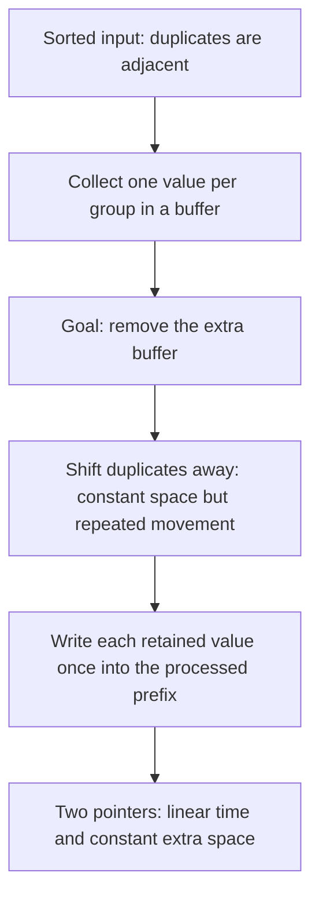

# 26. Remove Duplicates from Sorted Array

## Contract and connection to problem 27

Return the number `k` of distinct values and put those values in the first `k`
positions of `nums`, preserving their sorted order. The tail is ignored; the
physical Kotlin array does not shrink. The [official problem statement](https://leetcode.com/problems/remove-duplicates-from-sorted-array/description/)
guarantees a sorted, nonempty array (`1 <= nums.length`).

Your comparison idea is correct, but the meaning of `left` also changes:

| Detail | Problem 27: your removeElement | Problem 26: your removeDuplicates |
| --- | --- | --- |
| Keep a value when | It differs from the fixed `val` | It differs from the last unique value kept |
| Meaning of `left` | Next free output position | Index of last unique value kept |
| Valid output prefix | Indexes strictly below `left` | Indexes through `left`, inclusive |
| On keeping a value | Write, then increment `left` | Increment `left`, then write |
| Return | `left` | `left + 1` |
| Required output order | Any order | Original relative order |

The first value is already kept at index 0. That is why the return value starts
at one and why new values must be written after incrementing `left`.

## Solution evolution

Let `n = nums.size`. A natural interview progression builds on problem 27.

### 1. Baseline: collect unique values into a temporary buffer

Scan the sorted input. Append a value if the buffer is empty or if it differs
from the buffer's last value. Copy the buffer back into `nums` and return its
length. All duplicates are adjacent, so comparing with the last retained value
is sufficient; a set is unnecessary.

For `[1,1,2,2,3]`, the buffer evolves as:

```text
[] → [1] → [1] → [1,2] → [1,2] → [1,2,3]
     keep   skip   keep     skip      keep
```

This is O(n) time and O(n) auxiliary space in the worst case. It produces the
correct output but is an exploratory baseline if constant extra space is required.

What to say:

> “Since the array is sorted, equal values appear together. I can collect the
> first value of each group into a temporary buffer and copy it back. This is
> linear time, but the buffer can grow to the size of the input.”

### 2. Remove the buffer by shifting duplicates away

Track an active length. Starting at index 1, compare the current value with the
previous active value. If equal, shift the suffix left, decrease the active
length, and recheck the same index. Otherwise advance the index.

```text
[1,1,2,2,3] → [1,2,2,3 | 3] → [1,2,3 | 3,3]
 remove index 1                 remove index 2
```

The bar separates active data from ignored storage. Shifting preserves order
and removes one duplicate at a time, but can move the same values repeatedly.
For an all-equal input, shifts total `(n-2) + (n-3) + ... + 1`.
Worst-case time becomes O(n²), with O(1) auxiliary space.

What to say:

> “I can avoid the buffer by shifting values left whenever I find a duplicate.
> That saves space but can take quadratic time. It is a space improvement with
> a time tradeoff, so I want to avoid repeatedly shifting the same suffix.”

### 3. Combine linear scanning with in-place writing — your approach

Use the original array's prefix as the result buffer. `right` scans the input;
`left` identifies the last unique value already kept. Equal values are skipped.
For a different value, increment `left` and write the value there.

What to say:

> “The temporary buffer only grows as I scan, so its contents can fit in the
> already-processed prefix of the original array. I keep a read pointer and
> the index of the last unique value written. Because duplicates are adjacent,
> a value different from that last unique value begins a new group. I write
> it into the next prefix position. Each input is checked once, with no suffix
> shifting or extra buffer, giving O(n) time and O(1) auxiliary space.”



| Approach | Worst-case time | Extra space | Main cost |
| --- | --- | --- | --- |
| Temporary buffer and copy back | O(n) | O(n) | Extra storage |
| Shift on each removal | O(n²) | O(1) | Repeated suffix movement |
| Your two-pointer compaction | O(n) | O(1) | One scan |

## Your exact initialization

Your description starts `right` at 1; your code starts it at 0. Both work for
nonempty inputs. In your code the first comparison is `nums[0] != nums[0]`,
which is false, so it simply advances `right` to 1. Starting at 1 would skip
this redundant comparison; the implementation here preserves your version.

For an empty array your code would return 1, which would not be a valid count.
Empty arrays are outside this problem's constraints. If you later generalize the
function, add `if (nums.isEmpty()) return 0` before initializing the pointers.

## Every iteration: nums = [1,1,2,2,3]

Initially `left = 0`, `right = 0`; the first `1` is already the retained prefix.
Pointer pairs below are `(left, right)`; “after” includes `right++`.

| Step | Before | Comparison | Action | After | Physical nums | Retained prefix |
| --- | --- | --- | --- | --- | --- | --- |
| 1 | `(0,0)` | `1 != 1` false | Skip self-comparison | `(0,1)` | `[1,1,2,2,3]` | `[1]` |
| 2 | `(0,1)` | `1 != 1` false | Skip duplicate | `(0,2)` | `[1,1,2,2,3]` | `[1]` |
| 3 | `(0,2)` | `2 != 1` true | `left = 1`; `nums[1] = 2` | `(1,3)` | `[1,2,2,2,3]` | `[1,2]` |
| 4 | `(1,3)` | `2 != 2` false | Skip duplicate | `(1,4)` | `[1,2,2,2,3]` | `[1,2]` |
| 5 | `(1,4)` | `3 != 2` true | `left = 2`; `nums[2] = 3` | `(2,5)` | `[1,2,3,2,3]` | `[1,2,3]` |

Now `right == nums.size`, so stop and return `left + 1 = 3`.

```text
Index:       0  1  2  3  4
Initial:    [1, 1, 2, 2, 3]     left = right = 0
                  └── read 2 at index 2, write to index 1
After 2:    [1, 2 |2, 2, 3]     left = 1; prefix has two unique values
                     skip duplicate 2 at index 3
                     read 3 at index 4, write to index 2
Final:      [1, 2, 3 |2, 3]     left = 2; return 3
             valid    ignored
```

Old values in the tail do not need to be erased. Only the returned prefix matters.

## Correctness, safety, and termination

After the initial self-comparison, at the start of each iteration the prefix
`nums[0..left]` contains exactly the distinct values from the scanned input,
in order. `nums[left]` is its last value.

- If the current value equals that last value, skipping it preserves the prefix.
- If it differs, sorted order means it is larger and has not appeared earlier.
  Incrementing `left` and storing it extends the prefix by exactly one unique value.

Before processing each index from 1 onward, `left < right`. When a new value is
found, incrementing `left` therefore gives `left <= right`. The write is behind
the read pointer or at that same position, so it cannot destroy future input.

`right` advances every iteration and reaches `nums.size`. The prefix then contains
all unique values, and its inclusive last index `left` gives length `left + 1`.
Time is O(n); extra space is O(1). The arrays allocated by the test harness do
not count as allocations by your algorithm.

## Interview rehearsal

> “This is similar to Remove Element: I scan once and compact retained values
> into the front. Here the keep condition depends on the last unique value,
> rather than a fixed target. Sorted order makes duplicates adjacent, so one
> comparison is enough. My left pointer means the last occupied output index,
> so I increment before writing and return left plus one. Writes never pass
> the read pointer, making the operation safe in place.”

Practice explaining why writing before incrementing `left` would lose a value,
why `[1,2,1]` would break this method if unsorted input were allowed, and why an
all-equal nonempty input must return 1. Run `bash run.sh` to check your code.
