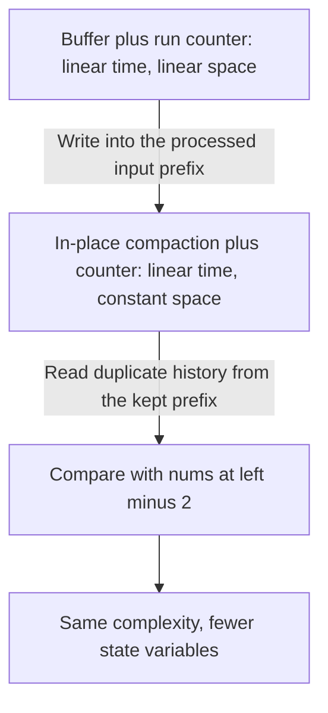

# 80. Remove Duplicates from Sorted Array II

## Contract and connection to problem 26

Given sorted input, retain up to two occurrences of each value in the original
order. Return the retained length; only that prefix of `nums` matters. The array
does not physically shrink, and the unused tail need not be cleared.

Your explanation and implementation agree. One important change from your
problem 26 code is the meaning of `left`:

| Detail | Your problem 26 code | Your problem 80 code |
| --- | --- | --- |
| `left` means | Index of last kept value | Next output position, also retained count |
| Kept prefix | `nums[0..left]` | `nums[0 until left]` |
| On accepting | Increment, then write | Write, then increment |
| Return | `left + 1` | `left` |
| Compare against | `nums[left]` | `nums[left - 2]` |

This problem's `left` convention matches your problem 27 implementation.
Do not mix the comparison offsets from one convention with the other.

## Solution evolution

Let `n` be the input length. There is no need to force a quadratic approach:
the sorted structure already gives a straightforward linear baseline.

### 1. Baseline: temporary buffer with a run counter

Scan the input, tracking how many times the current value has occurred in its
consecutive group. Reset the count when the value changes. Append a value to
a temporary buffer only for the first two occurrences, then copy the buffer back.

For `[1,1,1,2,2,3]`, the decisions are keep, keep, skip, keep, keep, keep,
giving `[1,1,2,2,3]`. Sorted order makes each value's occurrences contiguous,
so one counter per current group is enough; a frequency map is unnecessary.

Time is O(n), including copying back. Worst-case auxiliary space is O(n).
This is an exploratory baseline before satisfying constant extra space.

What to say:

> “I can scan each group of equal values, collect its first two entries into
> a buffer, and copy back. This is linear time, but the result buffer can be
> as large as the input. I want to reuse the original array for that output.”

### 2. Improve space: compact in place while keeping the counter

Use a write position in `nums` instead of a separate buffer. For each scanned
value, save the current value before writing, update the run count against a
saved previous input value, and write only if the count is at most two. After
processing, save that current value as the previous input value.

The write position never exceeds the read position, so unread input is safe.
This preserves O(n) time and reduces auxiliary space to O(1): a counter and
a few scalar variables replace the buffer.

What to say:

> “The output cannot grow faster than the scan, so I can write retained values
> into the processed prefix of nums. That removes the buffer. I can keep a
> counter to decide whether the current group already has two retained copies.”

### 3. Simplify the state: use the retained prefix itself — your code

The prefix already tells us whether the current value has two retained copies.
Its last two entries are at `left - 2` and `left - 1`. Compare the candidate
with the earlier of these two entries, `nums[left - 2]`.

This removes the explicit counter and previous-value state. It is a simplification,
not an asymptotic speedup: both in-place versions use O(n) time and O(1) space.

What to say:

> “Because the kept prefix is sorted, its last two positions tell me whether
> I have already kept two copies of the current value. If the candidate equals
> the value two output positions back, I skip it. Otherwise I write it at left
> and advance left. I can use the output as the record instead of a counter.”



## Why left - 2 works

Let the candidate be `x`. The kept prefix is sorted, and all of its values
are no greater than `x` because the input scan is ordered.

If `nums[left - 2] == x`, then:

```text
Kept prefix: [..., x, x]   Candidate: x
                  ^  ^               ^
             left-2 left-1        would be a third
```

The last kept value must also be `x`: it cannot be smaller than the preceding
`x` or larger than the current candidate `x`. Two copies are already kept.

If `nums[left - 2] != x`, it is smaller than `x`. Only the final kept position
could contain `x`, so there are at most one retained copy. Keeping the candidate
therefore gives at most two.

The comparison must use the **kept prefix**, not `nums[right - 2]`, because
earlier compaction changes input positions. For `[1,1,1,2,2]`, skip the third
`1`, then copy the first `2` into index 2. At `right = 4`, comparing with
`nums[right - 2]` now compares the second `2` with that copied `2`, wrongly
skipping a legal second copy. The correct reference is `nums[left - 2]`,
which is index 1 and still contains `1`. The output index tracks retained
history reliably.

## Initialization and boundaries

- If there are fewer than two elements, return the array length immediately.
- Otherwise, any first two elements are legal: they cannot exceed two copies.
  Keep them and start `left = right = 2`.
- Exactly two elements cause no loop iterations and return 2.
- `left` stays at least 2 in the loop, making `left - 2` a valid index.

## Every iteration: [1,1,1,2,2,3]

Initially `(left, right) = (2,2)`, and the kept prefix is `[1,1]`.
Pointer pairs below are `(left, right)`; after-state includes `right++`.

| Step | Before | Candidate vs reference | Action | After | Physical nums | Kept prefix |
| --- | --- | --- | --- | --- | --- | --- |
| 1 | `(2,2)` | `nums[2]=1`, `nums[0]=1` | Equal: skip | `(2,3)` | `[1,1,1,2,2,3]` | `[1,1]` |
| 2 | `(2,3)` | `nums[3]=2`, `nums[0]=1` | Write `nums[2]=2`; increment left | `(3,4)` | `[1,1,2,2,2,3]` | `[1,1,2]` |
| 3 | `(3,4)` | `nums[4]=2`, `nums[1]=1` | Write `nums[3]=2`; increment left | `(4,5)` | `[1,1,2,2,2,3]` | `[1,1,2,2]` |
| 4 | `(4,5)` | `nums[5]=3`, `nums[2]=2` | Write `nums[4]=3`; increment left | `(5,6)` | `[1,1,2,2,3,3]` | `[1,1,2,2,3]` |

`right` reaches 6, so the loop ends and returns `left = 5`.

```text
Index:         0  1  2  3  4  5
Initial:      [1, 1 |1, 2, 2, 3]    keep first two; skip third 1
After first 2:[1, 1, 2 |2, 2, 3]    next write index = 3
After next 2: [1, 1, 2, 2 |2, 3]    next write index = 4
After 3:      [1, 1, 2, 2, 3 |3]    return 5
               retained       tail
```

The bar marks the output boundary, not the scanning boundary. Values beyond it
may be unread input or stale values; `right` identifies what remains to scan.

## Correctness and complexity

At each loop entry, `nums[0 until left]` contains the processed input with each
value retained at most twice, in order. The comparison above admits exactly the
values that can be added without exceeding that limit. Skipping preserves the
prefix; accepting extends it by one valid value.

Initially `left == right`. Each iteration increments `right` once and `left`
at most once, so `left <= right` before each write. Thus no write destroys
future input. When the indexes are equal, the assignment simply writes the
current value back to itself.

`right` increases until it reaches the array length, so all input is processed
and the loop terminates. Since `left` is the next free output index, it is also
the count to return. Each iteration takes constant work: O(n) time and O(1)
auxiliary space. In-place mutation alone does not prove constant space; here
the evidence is that the method allocates no buffer and uses only scalar indexes.

## Interview rehearsal and transfer

> “This extends the previous compaction approach. I let left mean the next
> output position and keep the first two elements. For each later value, I
> compare it with the retained value at left minus two. If they match, sorted
> order means the last two retained values already equal this candidate, so I
> skip it. Otherwise I write it and advance left. The write index never passes
> the read index, so this is safe in place. I return left, with linear time and
> constant extra space.”

For an allowance of `limit >= 1`, the same idea keeps the first `limit` values
(returning early when the input is shorter) and compares against
`nums[left - limit]`. Sorted order is essential to that reasoning.

Practice: why would comparing with `left - 1` allow only one copy? Why does this
version return `left` while your problem 26 version returns `left + 1`? Trace
`[0,0,1,1,1,1,2,3,3]` and predict each comparison before running `bash run.sh`.
