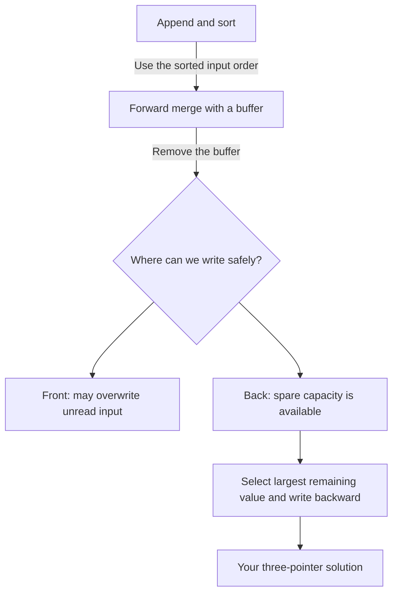
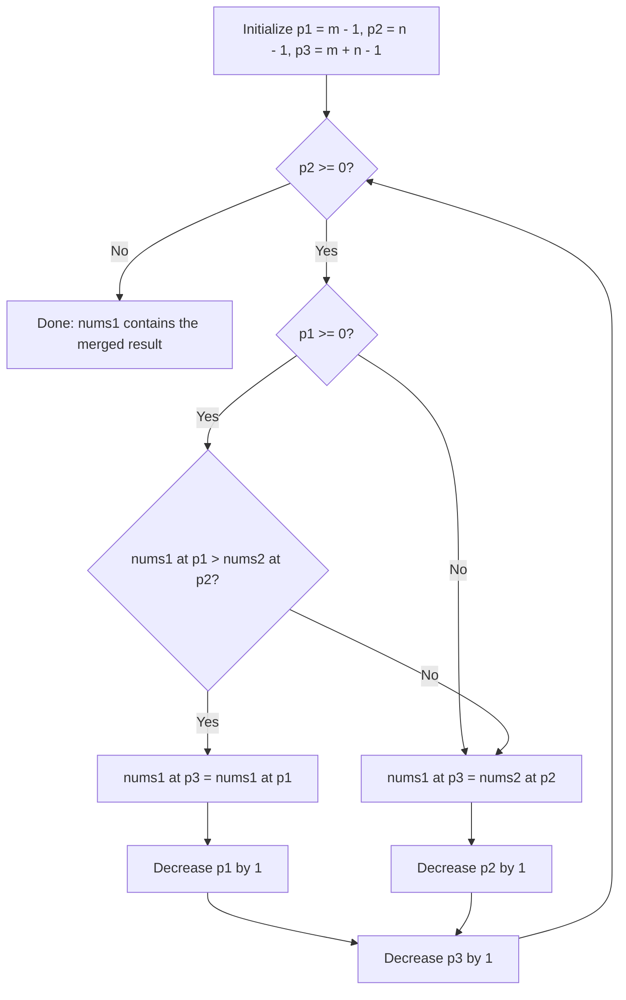

# 88. Merge Sorted Array: understanding your solution

Your implementation passes all six local tests. It uses three pointers to merge
from right to left, modifying `nums1` in place.

## Solution evolution

The interview goal is to explain what each approach costs, what you notice about
the problem, and how that observation motivates the next approach. Here is one
natural progression toward your code. Let `N = m + n`.

### Establish the contract first

What to say:

> “Both input portions are sorted, and only the first `m` entries of `nums1`
> are input values. I need to put all `m + n` values into that same array.
> Can either input be empty, and is constant auxiliary space required?”

The examples include empty inputs. We will reach constant auxiliary space;
an intermediate buffer is useful for deriving the solution. If an interviewer
requires constant space from the outset, label that buffer approach as an
exploratory step that still needs improvement.

### 1. Straightforward baseline: append and sort

Copy the `n` values from `nums2` into the unused tail of `nums1`, then sort all
`N` entries. This works because the array now contains exactly the required
multiset of values, and sorting puts them in order.

```text
nums1:                  [1,2,3,0,0,0]
copy nums2 into tail:   [1,2,3,2,5,6]
sort:                  [1,2,2,3,5,6]
```

Pseudocode: `copy nums2 into nums1 starting at m; sort nums1`.

With a comparison sort taking O(N log N) time, this costs O(N log N) overall.
Auxiliary space depends on the chosen sorting implementation; sorting an array
“in place” does not by itself prove O(1) auxiliary space. We need not rely on a
particular library's implementation to see the main bottleneck.

What to say:

> “A simple baseline is to fill the spare positions with the second array and
> sort the result. That gives the correct values in order, but sorting costs
> O(N log N). It ignores the fact that the two input portions are already sorted.”

**Observation leading to improvement:** we do not need to rediscover the entire
ordering. The smallest unread value must be at the front of one of the inputs.
Compare just those two candidates and consume the smaller one.

This is a straightforward baseline, not exhaustive brute force. There is no need
to invent a permutation-search solution just to begin with something slower.

### 2. Improve time: merge forward into a temporary array

Use one pointer at the beginning of each input and an empty output buffer.
Append the smaller current value, move that input pointer, and repeat. Once
one input is exhausted, append the other input's remainder. Copy the buffer
back into `nums1` to satisfy the mutation requirement.

```text
Unread input A    Unread input B    Buffer after taking the next value
[1,2,3]           [2,5,6]           []
[2,3]             [2,5,6]           [1]
[3]               [2,5,6]           [1,2]       choose A on this tie
[3]               [5,6]             [1,2,2]
[]                [5,6]             [1,2,2,3]
[]                [6]               [1,2,2,3,5]
[]                []                [1,2,2,3,5,6]
Then copy the buffer back to nums1.
```

Each choice is correct because all other unread values in that input are at
least as large as its current first value. Every value is consumed once, and
copying back takes another linear pass: **O(N) time, O(N) auxiliary space**.

What to say:

> “Since the inputs are sorted, I can merge them with two forward pointers.
> Each value is processed once, so time becomes O(N), including copying back.
> The remaining cost is the O(N) buffer. Can I use the spare capacity in nums1
> as the destination instead?”

**Obstacle:** writing directly at the front may destroy unread input. With
`nums1 = [4,5,6,0,0,0]` and `nums2 = [1,2,3]`, writing `1` at index 0 loses
the unread `4`. Shifting values right to preserve them is possible, but repeated
shifting can cost O(mn + n) time in the worst case.

**Observation leading to improvement:** spare capacity is at the back. Sorted
inputs reveal the largest unread values at their ends just as readily as the
smallest values at their beginnings. Reverse the direction of both selection
and writing.

### 3. Improve space: merge backward into nums1 — your implementation

Set `p1 = m - 1`, `p2 = n - 1`, and `p3 = N - 1`. Choose the larger unread
value, write it at `p3`, then move that source pointer and `p3` left.

For the same example, the writes are `6 → index 5`, `5 → index 4`,
`3 → index 3`, and `2 → index 2`. The untouched prefix `[1,2]` is already
correct. The detailed execution trace below shows every comparison and update.

This preserves O(N) worst-case time while reducing auxiliary space to **O(1)**.
The sorted suffix grows one position at a time. While `nums2` still has values,
`p3 > p1`, so a write cannot overwrite unread input in `nums1`.

What to say:

> “The free positions are at the back, so I can place the largest remaining
> value first. I use two read pointers and one write pointer. This keeps the
> merge linear and removes the buffer. I stop when nums2 is exhausted because
> any remaining nums1 prefix is already where it belongs.”

O(N) is optimal in the worst case: valid inputs can require changing all N
output positions. For example, merging `[4,5,6,0,0,0]` with `[1,2,3]` changes
every entry. That does not mean every input needs N operations: when `n = 0`,
your loop performs no iterations.

### Compare the approaches

| Approach | Time | Auxiliary space | What motivates the next step? |
| --- | --- | --- | --- |
| Append, then comparison sort | O(N log N) | Sort-dependent | Already-sorted inputs make general sorting unnecessary. |
| Forward merge into a buffer, then copy back | O(N) | O(N) | Spare tail capacity can replace the buffer if writing is safe. |
| Backward merge into nums1 | O(N) worst case | O(1) | Meets the time and space goals. |



### Rehearse the progression aloud

> “First, I could append nums2 and sort, which takes O(N log N) with a suitable
> comparison sort. But both inputs are already sorted, so comparing their next
> values gives a linear merge. A forward merge into a temporary array works,
> but needs O(N) extra space. Writing that merge directly at the front could
> overwrite unread values. Since nums1 has spare capacity at the back, I can
> instead compare the largest remaining values and fill backward. That reaches
> O(N) time and O(1) extra space. The completed suffix stays sorted, and once
> nums2 is consumed, the remaining nums1 prefix is already correct.”

Practice each transition separately: What information does sorting ignore?
Why does the forward version need a buffer? What concrete input demonstrates
the overwrite problem? Why does changing direction solve it?

## Derive the final pointers and loop

1. **Identify the actual input.** Only `nums1[0 until m]` contains input values.
   Its last `n` positions are available space. A zero is not a marker: zero can
   also be a real input value. Use the lengths to distinguish input from space.
2. **Use the sorted order.** The largest remaining value in each array is at
   the end of its unprocessed portion. Comparing those two values tells us the
   largest remaining value overall.
3. **Choose a safe writing direction.** Writing a small value at the front
   could overwrite an unread value in `nums1`. For example, inserting `1` at
   the front of `[4,5,6,0,0,0]` would destroy the `4`. The spare positions are
   at the back, so put the largest value there first.
4. **Track two inputs and one output.** `p1` and `p2` select the largest unread
   inputs; `p3` selects the position to fill. After a write, move the selected
   input pointer left and always move the output pointer left.
5. **Stop when the second array is consumed.** Any values left in the first
   array are already in their correct positions. If the first array runs out
   sooner, keep copying from the second array.

This is a way to reason about the algorithm from the problem constraints, not
a claim about the exact thoughts you had while writing it.

## Connect the variables to the code

| Code | Meaning |
| --- | --- |
| `p1 = m - 1` | Last unread input index in `nums1`; `-1` means exhausted. |
| `p2 = n - 1` | Last unread input index in `nums2`; `-1` means exhausted. |
| `p3 = m + n - 1` | Next output index in `nums1`, working backward. |
| `while (p2 >= 0)` | Continue until every element from `nums2` is placed. |
| `p1 >= 0 && nums1[p1] > nums2[p2]` | Use `nums1` only if it still has an input and that input is larger. |
| `else` | Use `nums2` when it is larger, equal, or `nums1` is exhausted. |

Kotlin's `&&` short-circuits: when `p1 < 0`, it does not evaluate `nums1[p1]`.
The loop condition guarantees that `nums2[p2]` is valid inside the loop.
Either source is valid on a tie; your code chooses `nums2`.

## Control flow



## Every iteration of example 1

Input: `nums1 = [1,2,3,0,0,0]`, `m = 3`, `nums2 = [2,5,6]`, `n = 3`.
All indexes below are zero-based. Pointer triples are `(p1, p2, p3)`.

| Iteration | Pointers before | Comparison | Write | Pointers after | Physical contents of nums1 |
| --- | --- | --- | --- | --- | --- |
| 1 | `(2,2,5)` | `3 > 6` is false | `nums1[5] = 6` | `(2,1,4)` | `[1,2,3,0,0,6]` |
| 2 | `(2,1,4)` | `3 > 5` is false | `nums1[4] = 5` | `(2,0,3)` | `[1,2,3,0,5,6]` |
| 3 | `(2,0,3)` | `3 > 2` is true | `nums1[3] = 3` | `(1,0,2)` | `[1,2,3,3,5,6]` |
| 4 | `(1,0,2)` | `2 > 2` is false | `nums1[2] = 2` | `(1,-1,1)` | `[1,2,2,3,5,6]` |

The following diagram separates unread input from completed output. `_` means
an irrelevant position: the physical array may contain a zero or an old copied
value there. Reading is controlled by the pointers, not by clearing positions.

```text
                          nums1                               nums2 unread
                 unread   | unfinished | completed
Start:           [1 2 3]  | [_ _ _]    | []                   [2 5 6]
                            write index 5 <---------------------- 6

After step 1:    [1 2 3]  | [_ _]      | [6]                  [2 5]
                            write index 4 <-------------------- 5

After step 2:    [1 2 3]  | [_]        | [5 6]                [2]
                      3 --> write index 3

After step 3:    [1 2]    | [_]        | [3 5 6]              [2]
                            write index 2 <------------------ 2

After step 4:    [1 2]    | []         | [2 3 5 6]            []
                 already correct       placed by the loop

Final:          [1 2 2 3 5 6]
```

In step 3, the old `3` at index 2 remains physically present, but it is no
longer unread input: `p1` has moved to index 1. Step 4 safely overwrites it.
The loop ends with `p2 = -1`; the initial `[1,2]` needs no further copying.

## Why overwriting is safe, and why stopping is correct

At the start of each iteration, the suffix strictly to the right of `p3`
already contains the largest values in their final sorted positions. The two
input prefixes through `p1` and `p2` hold the remaining values. Choosing the
larger of their last elements places the next correct value at `p3`.

The pointers also satisfy `p3 = p1 + p2 + 1`. This is true initially, and each
iteration decreases `p3` and exactly one input pointer by one. While `p2 >= 0`,
we therefore have `p3 > p1`: writing at `p3` cannot destroy unread `nums1` input.

Each iteration consumes one input value. Once `p1` is exhausted, each remaining
iteration consumes `nums2`, so the loop terminates. When `p2 = -1`, the pointer
relationship becomes `p3 = p1`. Any remaining first-array prefix already occupies
the output positions where it belongs.

## Boundary cases

- **`n = 0`:** `p2 = -1`; the loop never runs and `nums1` is already the answer.
- **`m = 0`:** `p1 = -1`; every iteration takes the `else` branch and copies `nums2`.
- **Equal values:** taking from `nums2` on a tie still produces sorted output.
- **Negative values and zeros:** ordinary comparisons work; no value is treated as a sentinel.

Worst-case time is **O(m + n)** and extra space is **O(1)**. The existing output
capacity is provided by the caller; your implementation allocates no extra array.
The local test runner's copies are testing machinery, not part of the algorithm.

## A short interview explanation

“Both inputs are sorted, and the first array has spare space at the end. I compare
the largest unread values and write the larger one into the last unfilled
position. I move that input pointer and the write pointer left, repeating until
the second array is consumed. Any remaining first-array values are already in
place. This takes O(m + n) time and O(1) extra space.”

## Practice without looking at the trace

1. Trace `[4,5,6,0,0,0]` and `[1,2,3]`. When does `p1` become `-1`, and which branch runs next?
2. Explain why `while (p1 >= 0 && p2 >= 0)` alone would miss work.
3. Change `>` to `>=` mentally. Does the integer result change? Which source wins ties?
4. Rebuild the solution from the pointer meanings, then run `bash run.sh`.
